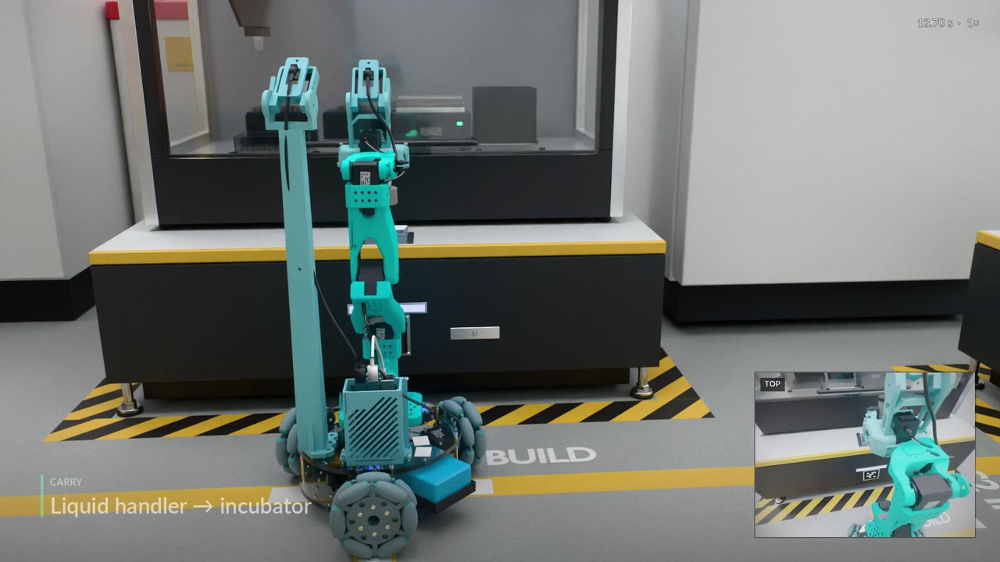

# LeRobot CAD Studio

Design 3D-printed parts for a LeRobot robot with your AI agent, check that they print and fit, then drive the robot in MuJoCo. All in one browser page.

[](https://zuoxingdong.github.io/lerobot-cad-studio/showcase.html)

## Motivation

**Changing one printed part usually means a CAD tool, a slicer and a simulator.** A bad fit or a blocked camera shows up only after the print.

**Most robot builders have no CAD skills, but most have an AI coding agent.** The studio turns a part request into a prompt for that agent, then checks the part the agent returns.

**Edit, checks and physics share one page.** No install, no account.

**Robots:** LeKiwi + PincOpen (the default) and stock LeKiwi.

## Quick start

**Online: open https://zuoxingdong.github.io/lerobot-cad-studio/.** Your design stays in the page; it loads only one font from Google Fonts.

**Local: Node 22 and npm.**

```bash
npm ci
npm run build    # writes site/, the same site Pages serves
npm run serve    # http://127.0.0.1:8099/lerobot-cad-studio/
```

## Core features

- **Ask agent: describe the part you want, your AI agent builds the STL.** The page writes the prompt and a context pack; the folder the agent returns becomes a new option for that part.
- **Design: select a part and change it.** Stretch, Scale, Thicken, Mirror, Move or Tilt it, or swap in another mount option.
- **Check: every problem in one table.** Print (closed, one body, flat, fits the bed), Fit (touches only what it bolts to; the arm clears it at every preset), Limits (every arm preset inside the joint limits), Cameras (gripper in frame, robot not filling the view).
- **Sim: drive the robot and its arm in MuJoCo, in the browser.** Or run the lab task: a sample puck from the liquid handler to the incubator, then the reader.
- **Export: STL zip, design JSON or MuJoCo MJCF zip.** Only a failed check blocks an export, and you can waive it per part.

## Citation

```bibtex
@software{zuo2026lerobotcadstudio,
  author = {Zuo, Xingdong},
  title  = {LeRobot CAD Studio: interactive 3D-print design and MuJoCo evaluation for LeRobot robots},
  year   = {2026},
  url    = {https://zuoxingdong.github.io/lerobot-cad-studio}
}
```

## Acknowledgements

Built on [LeKiwi](https://github.com/SIGRobotics-UIUC/LeKiwi) by SIGRobotics-UIUC, [SO-101 and LeRobot](https://github.com/huggingface/lerobot) by Hugging Face, [PincOpen](https://github.com/pollen-robotics/PincOpen) by Pollen Robotics, [MuJoCo](https://mujoco.org) and [three.js](https://threejs.org).

**Licences:** code Apache-2.0 ([LICENSE](LICENSE)); geometry per part, see [assets/LICENSE-GEOMETRY.md](assets/LICENSE-GEOMETRY.md).
