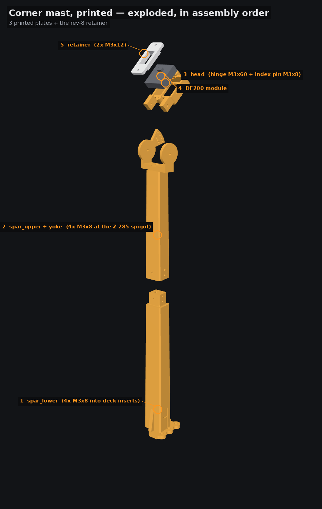
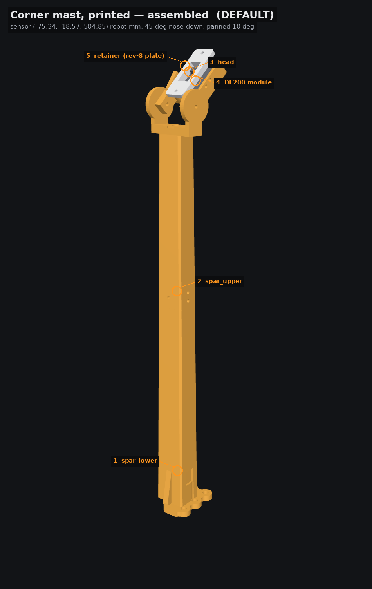

# Corner mast (printed spar) — assembly · **the default overhead mount**

**Three printed plates. No metal, no hardware store, no drilling.** Plus the shared retainer you
have already printed.

> **Both halves need 250 mm of Z.** `spar_lower` is **248.0 mm** tall and `spar_upper` is
> **229.6 mm**. A Prusa MK4 (220 mm) will not take either; an Ender 3 (250 mm) takes the taller
> one with **2.0 mm** to spare, so check your gantry clearance before you start. No shorter
> variant of this mount ships.

## Print these

| plate | exported as | bed | PLA @ 1.24 g/cm³ | first layer | overhang | worst span | supports |
|---|---|---|---|---|---|---|---|
| `print/spar_lower_PRINT.stl` | `corner_mast_printed_spar_lower_PRINT.stl` | 45.5 × 58.5 × **248.0** mm | 142.3 g | **2098 mm²** | 1.0 % | 9.2 mm | none |
| `print/spar_upper_PRINT.stl` | `corner_mast_printed_spar_upper_PRINT.stl` | 58.9 × 60.0 × **229.6** mm | 90.0 g | **337 mm²** | 2.7 % | 18.3 mm | none |
| `print/head_PRINT.stl` | `corner_mast_printed_head_PRINT.stl` | 43.4 × 68.5 × 17.5 mm | 17.0 g | **976 mm²** | 5.5 % | 23.7 mm | **yes, under the two hinge-lug ends** |

The left-hand name is the file in the `print/` folder beside this document; the right-hand one
is what the studio's export writes, because the wrist arch ships a `head_PRINT.stl` too and the
two must not collide inside one zip.

…plus the two SHARED plates, which are separate print-only upgrades and are not in this folder:
**Camera retainer plate** (`../cam_retainer/print/camera_retainer_PRINT.stl`) and, only if your module is under 11 mm
deep, **Camera pocket shims** (`../camera_shims/print/camera_shims_PRINT.stl`). This set ships neither: the
retainer is the same solid to 0.005 mm, measured on the exported meshes, and the shared shims
are 36 × 36 × 0.4 / 0.8 / 1.6 mm.

**249.3 g of PLA in three prints.**

## Prepare the deck (once)

The four deck grid holes measure **Ø3.50** as they come, and the deck plate is **7.0 mm** thick
(Z 50 → 57). Both are measured on the stock deck mesh.

1. **Open (−60, −60), (−60, −40), (−60, −20) and (−80, −20) to Ø4.0** with a hand drill.
2. **Melt an M3 × 5.7 brass heat-set insert into each**, flush with the deck's top face; it then
   occupies Z 57.0 → 51.3 and leaves 1.3 mm of hole under it.

Three of the four bolts sit over the **LiPo** (pack top Z 46.5, deck underside Z 50.0 — 3.4 mm of
air). With a nut under the deck you fit it blind, in a 3.5 mm slot, with the bolt tip 1.3 mm off
the pack. With inserts the **M3 × 8 stops at Z 51.8** and nothing protrudes below the deck at all,
so the battery never comes out.

## Order of operations

1. **Bolt `spar_lower` down** — 4 × **M3 × 8** into the inserts. Head bears at Z 59.80 on a
   2.80 mm pad, so **5.20 mm** of the 5.70 mm insert is engaged. Access, cast against the
   assembled robot: **60 mm of clear Ø7** at three of the four, **26 mm** at (−60, −40) where the
   spar's own corner overhangs (that is what the Ø7.5 × 26 driver relief above every bolt is
   for); 60 mm of Ø6 and Ø3.6 at all four.
2. **Thread the camera cable up the hollow spar now**, from the cable slot on the +X face at
   Z 85–101 to the open top. Leave a 60 mm service loop at the head. Do it before step 3: the
   spigot joint closes the route.
3. **Fit `spar_upper` on the Z 285 spigot.** The section is a chamfered rectangle, so it goes
   together **two ways round only** — line up the two printed **witness chevrons** on the −X face
   so they point at each other. Get this wrong and the camera looks at the wall behind the robot.
   The fit is **0.350 mm per side laterally and 0.180 mm fore-aft** (measured on the exported
   meshes, both halves 0.0000 mm³ of interference): tighter in the plane the head's overhang
   bends the mast in, looser where it only has to slide.
4. **Pin the joint** — **3 × M3 × 8**: two on +X at Z 292 and Z 301, one on −Y at Z 296.5.
   60 mm of clear Ø7 on all three.
5. **Hang the head** on the **M3 × 60 + nyloc** hinge bolt straight into the cheeks on top of
   `spar_upper` (54.20 mm of stack, 5.80 mm proud; an M3 × 55 leaves 0.80 mm of thread and cannot
   take a nut). 60 mm of clear driver on the head side, 14 mm — the full cast — on the nut side.
6. **Set the tilt detent** — 1 × **M3 × 8** through the outboard cheek's index fan into the
   head's own seat. Shipped hole **45°** (40…70° in 5° steps, on two rings at r 25 and r 33).
   The seat is **blind, 3.0 mm deep**: 5.00 cheek + 0.40 gap leaves 2.60 mm in it, and the pin
   cannot reach the camera module — **0.00 mm³** at all seven detents.
7. **Insert the DF200 module** from the rear and fit the **retainer** (2 × M3 × 12 self-tapping
   into the head's ears, Ø2.60 × 9.50 pilots, 8.0 mm of bite). The retainer closes the insertion
   corridor, so it is always last.

## Pan

**Pan is fixed at the design 10°**, by the spigot's own section — there is no adjustment and no
screw that could give one. That is the price of deleting the collar, the clamp and the pan ring.
To re-aim in pan, regenerate the spar with a different `pan_deg`; the parameter is in
`record.json → params`.

## Fastener access, as measured

| fastener | qty | axis | Ø7 driver | Ø6 | Ø3.6 key | verdict |
|---|---|---|---|---|---|---|
| deck M3 × 8 (−60, −60) | 1 | +Z | **60.0** | 60.0 | 60.0 | driver |
| deck M3 × 8 (−60, −40) | 1 | +Z | 26.0 | **60.0** | 60.0 | driver |
| deck M3 × 8 (−60, −20) | 1 | +Z | **60.0** | 60.0 | 60.0 | driver |
| deck M3 × 8 (−80, −20) | 1 | +Z | **60.0** | 60.0 | 60.0 | driver |
| spigot M3 × 8, +X (Z 292) | 1 | +X | **60.0** | 60.0 | 60.0 | driver |
| spigot M3 × 8, +X (Z 301) | 1 | +X | **60.0** | 60.0 | 60.0 | driver |
| spigot M3 × 8, −Y (Z 296.5) | 1 | −Y | **60.0** | 60.0 | 60.0 | driver |
| hinge M3 × 60, head (outboard) | 1 | −xd | **60.0** | 60.0 | 60.0 | driver |
| hinge M3 × 60, nut (inboard) | 1 | +xd | **14.0** (full cast) | 14.0 | 14.0 | nut driver |
| index pin M3 × 8 (outboard cheek) | 1 | −xd | **60.0** | 60.0 | 60.0 | driver |
| retainer M3 × 12, image-up ear | 1 | −n | **60.0** | 60.0 | 60.0 | driver |
| retainer M3 × 12, image-down ear | 1 | −n | **60.0** | 60.0 | 60.0 | driver |

mm of clear tube from the bearing face. **No fastener of this set is blocked, and none needs a
ball-end key.** (The witness chevrons are on the −X face precisely because two of the three
spigot screws come in on +X: put one on their axis and the driver reads 0.00 mm.)

## Bill of materials

| qty | item | where |
|---|---|---|
| 4 | **M3 × 5.7 brass heat-set insert** (Ø4.6 knurl) | the four deck grid holes, opened to Ø4.0 |
| 4 | **M3 × 8** socket cap | `spar_lower` → the inserts (5.20 mm of engagement; nothing below the deck) |
| 3 | **M3 × 8** | the Z 285 spigot joint |
| 1 | **M3 × 60 + nyloc** | the hinge (54.20 mm of stack — *not* M3 × 55) |
| 1 | **M3 × 8** | the tilt index pin (blind 3.0 mm seat) |
| 2 | M3 × 12 self-tapping | the camera retainer |
| 1 | JR DF200 camera module | the pocket |

**No aluminium, no nuts except the hinge nyloc, nothing drilled.**

## Stiffness, measured on the exported sections

Tip deflection at 1 g **0.298 mm fore-aft / 0.259 mm lateral, first mode 34.4 / 36.9 Hz** — from
a beam solve over EI(z) sectioned from these meshes at 1 mm stations, with head + retainer +
module as lumps at their own centres of mass.

## Verification, on the exported meshes

| test | result |
|---|---|
| 36.4 × 36.4 module swept 40 mm out of the pocket | **0.0022 mm³** (tessellation) |
| all seven detents 40…70°, with real Ø3.0 bolts and pins | **0.0000 mm³** against head, `spar_upper` **and the module** |
| spigot fit, measured half-widths | **0.350 mm/side lateral, 0.180 mm/side fore-aft**; the two halves intersect by **0.0000 mm³** |
| fastener access, 12 fasteners | **0 blocked**, 0 ball-end-only |
| arm-fouling sweep, full grid | **289 forward-working poses, 0 fouled (0.0 %)** |
| raised-arm envelope \|X\| < 45, Y −100…325, Z < 586 | **0 vertices inside** |
| camera pose vs the generator | **0.000000 mm**, axis error 0 |
| every mesh and plate | watertight, single body, plate on Z = 0.000000 |
