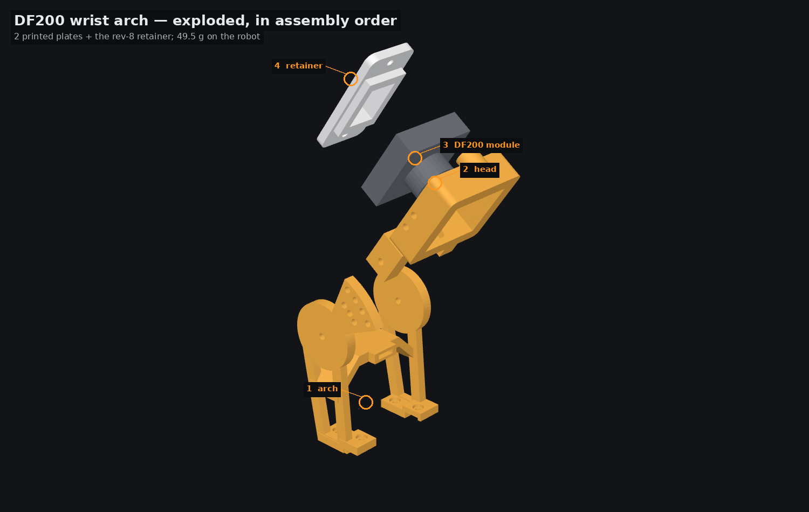
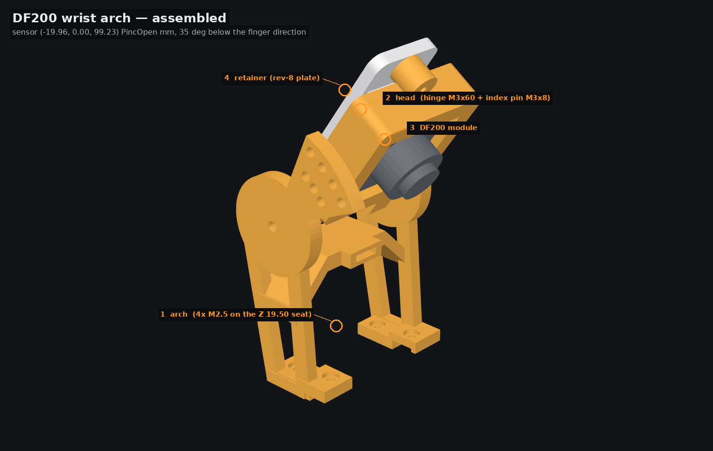

# DF200 wrist arch — assembly

**Two printed plates**, 42.0 g — 49.4 g with the shared retainer you have already printed,
against a 60 g budget.

Every clearance below is **measured** by casting a driver cylinder along the fastener's own axis
against the **fully assembled robot** (LeKiwi + PincOpen + corner mast + this arch, parked pose,
exported meshes).

## Print these

| plate | exported as | bed | PLA @ 1.24 g/cm³ | first layer | overhang | worst span | supports |
|---|---|---|---|---|---|---|---|
| `print/arch_PRINT.stl` | `df200_arch_arch_PRINT.stl` | 49.3 × 54.2 × 88.3 mm | 25.0 g | **398.5 mm²** | 12.5 % | 22.5 mm | **yes** — both cheek undersides, the fan's lower edge, and the crown hump |
| `print/head_PRINT.stl` | `df200_arch_head_PRINT.stl` | 43.4 × 68.5 × 17.5 mm | 17.0 g | **976 mm²** | 5.5 % | 23.7 mm | **yes** — under the two hinge-lug ends |

The left-hand name is the file in the `print/` folder beside this document; the right-hand one
is what the studio's export writes, because the corner mast ships a `head_PRINT.stl` too.

…plus the two SHARED plates, which are separate print-only upgrades and are not in this folder:
**Camera retainer plate** (`../cam_retainer/print/camera_retainer_PRINT.stl`, the same solid as this set's retainer to
0.005 mm), and **Camera pocket shims** (`../camera_shims/print/camera_shims_PRINT.stl`) only if your module is
under 11 mm deep. This set ships neither.

**The arch prints UPRIGHT**, standing on its own two seat rails — the very faces that have to be
flat, because they are the datum it seats on: **398.5 mm²** of flat bed contact and 12.5 %
overhang, the best of a 168-orientation search.

`head_PRINT` is **the same geometry as the corner mast's** — the blind index seats are cut in
both side walls, so one print serves both mounts. The two ship under different export names, so
print the file once and fit it to whichever mount you are building; you need two only if you
build both.

## Order of operations

> **Bolt the arch on BEFORE the gripper goes back on the wrist.** The stock wrist-roll bracket
> (`Wrist_Roll_08c-v1`) sits 1.0 mm over the rear seat pair. With the arm assembled the rear
> pair takes a 26 mm straight key or a ball-end; with the gripper off the bench, all four take a
> driver.
>
> **Remove `Camera_basement` and `Camera_mobile_sup`** — the upstream PincOpen camera stand. This
> arch replaces them and occupies the same volume (456 mm³ of overlap, measured).

1. **Bolt the arch to the camera seat** — 4 × M2.5 into the Z 19.50 pattern at
   X −41.27 / −26.27, Y ±18.91:
   * **rear pair (X −41.27): M2.5 × 8.** Head bears at Z 22.00 on 2.50 mm of pad, 2.50 mm of
     stack, **5.50 mm of thread** in the Top_Plate's 6.61 mm blind hole — 1.11 mm spare.
   * **front pair (X −26.27): M2.5 × 10.** These stand on the Motor_Flange's own feet. Head
     bears at Z 24.20; 2.50 pad + ≤ 0.34 air + 2.00 flange foot = 4.70 mm of stack, **5.30 mm of
     thread** — 1.31 mm spare.
   * Hand torque, no washer: the Ø5.4 × 1.5 counterbore leaves **2.50 mm** of pad under each
     head.
2. **Plug the servo in.** The crossbar humps over the STS3215's two 3-pin sockets: **18.1 mm of
   clear air** over the socket face, and the corridor X −54.2…−6.8, |Y| ≤ 13, up to Z 57.4 is
   kept empty by an unconditional cut — an 18 × 22 × 16 mm plug envelope and the full
   18 × 26 × 18.1 mm corridor both measure **0.0000 mm³** against the arch. Tie the harness
   through the **zip-tie lug** on the front of the crown.
3. **Hang the head** on the **M3 × 60 + nyloc** hinge bolt (54.20 mm across both cheeks).
   60 mm of clear driver on the head side, 14 mm — the full cast — on the nut side.
4. **Set the tilt detent** — 1 × **M3 × 8** through the fan cheek into the head's **blind
   3.0 mm** seat. **Shipped hole: 35°** (30…60° in 5° steps). The pin cannot reach the camera
   module: **0.00 mm³** at all seven detents.
5. **Insert the DF200 module** from the rear and fit the **retainer** — 2 × M3 × 12 self-tapping
   into the head's ears. Tie the pigtail round a leg with a 40 mm service loop.

## Why 35° and not 40°

The framing model now measures from the lens's **entrance pupil**, 8 mm in front of the sensor
point, not from the sensor: the module's own barrel (Ø20 × 9) and hood (Ø13 × 3) stand 4–16 mm
proud of it, and an M12 board lens projects from 6–10 mm forward. At **40°** the drive servo's
LED is **−0.61°** — *inside* the frame (+1.25° at a 6 mm pupil, −2.53° at 10 mm). At **35°** the
margin is **+6.66°** (+8.50 / +4.78), clear of the 4.7° rule at every pupil offset in the
bracket. Only 30° and 35° pass every gate. **This is a pin, not a reprint.**

## Fastener access, as measured

| fastener | qty | axis | Ø7 driver | Ø3.6 key | ball-end | verdict |
|---|---|---|---|---|---|---|
| seat M2.5 × 8, rear +Y (−41.27, +18.91) | 1 | +Z | 0.50 | **26.3** | 60.0 | key |
| seat M2.5 × 8, rear −Y (−41.27, −18.91) | 1 | +Z | 0.50 | **26.3** | 60.0 | key |
| seat M2.5 × 10, front +Y (−26.27, +18.91) | 1 | +Z | **42.2** | 51.7 | 60.0 | driver |
| seat M2.5 × 10, front −Y (−26.27, −18.91) | 1 | +Z | **42.6** | 51.7 | 60.0 | driver |
| hinge M3 × 60, head (−Y, fan side) | 1 | −Y | **60.0** | 60.0 | 60.0 | driver |
| hinge M3 × 60, nut (+Y) | 1 | +Y | **14.0** (full cast) | 14.0 | 14.0 | nut driver |
| index pin M3 × 8 (−Y cheek) | 1 | −Y | **60.0** | 60.0 | 60.0 | driver |
| retainer M3 × 12, image-up ear | 1 | −n | **60.0** | 60.0 | 60.0 | driver |
| retainer M3 × 12, image-down ear | 1 | −n | **60.0** | 60.0 | 60.0 | driver |

mm of clear tube from the bearing face. **No fastener of this set is blocked**; the rear −Y
screw takes a 26 mm straight key from either side. A Ø7 socket never
fits an M2.5 head anyway — the counterbore is Ø5.4 and the relief above it is Ø6.0, sized for a
2.5 mm key; what the Ø7 column records at the rear pair is the wrist-roll bracket 1.0 mm above
the rail.

## Bill of materials

| qty | item | where |
|---|---|---|
| 2 | **M2.5 × 8** | rear seat pair, X −41.27 (5.50 mm of thread, 1.11 mm spare) |
| 2 | **M2.5 × 10** | front seat pair, X −26.27 (5.30 mm of thread, 1.31 mm spare) |
| 1 | **M3 × 60 + nyloc** | the head hinge (54.20 mm across both cheeks) |
| 1 | **M3 × 8** | the tilt index pin (blind 3.0 mm seat) |
| 2 | M3 × 12 self-tapping | the camera retainer |
| 2 | 2.5 mm zip tie | one through the crown lug for the servo harness, one round a leg for the DF200 pigtail |
| 1 | JR DF200 camera module | the pocket |

## Verification, on the exported meshes

| test | result |
|---|---|
| 36.4 × 36.4 module swept 40 mm out of the pocket | **0.0017 mm³** |
| all seven detents 30…60°, head + retainer vs arch | **0.0000 mm³** each |
| a real Ø3.0 hinge bolt and Ø3.0 index pin at every detent | **0.0000 mm³** into arch, head **and the module** |
| plug envelope 18 × 22 × 16 and the full corridor 18 × 26 × 18.1 ∩ arch | **0.0000 mm³** |
| jaw sweep 0 → 40 mm vs all 22 PincOpen parts | `top_plate` **0.578 mm³** (the zero-thickness seat skin — 0.003 mm deep), `camera_basement` **456 mm³** (the stand this arch replaces); **everything else 0**, including the Motor_Flange |
| wrist roll −180 → +180° in 15° steps, mount vs the wrist assembly | constant **479 mm³** against the stock SO-101 fixed jaw, inside the stated PincOpen↔wrist registration error |
| fastener access, 9 fasteners | **0 blocked**, 0 ball-end-only |
| leg wall thickness (17-ray SDF, opposing-face filter) | **0.10 %** of the arch's surface under 1.2 mm, 1st-percentile wall **1.40 mm** |
| flat bed contact in the print orientation | **398.5 mm²** |
| every mesh and plate | watertight, single body, plate on Z = 0 |
